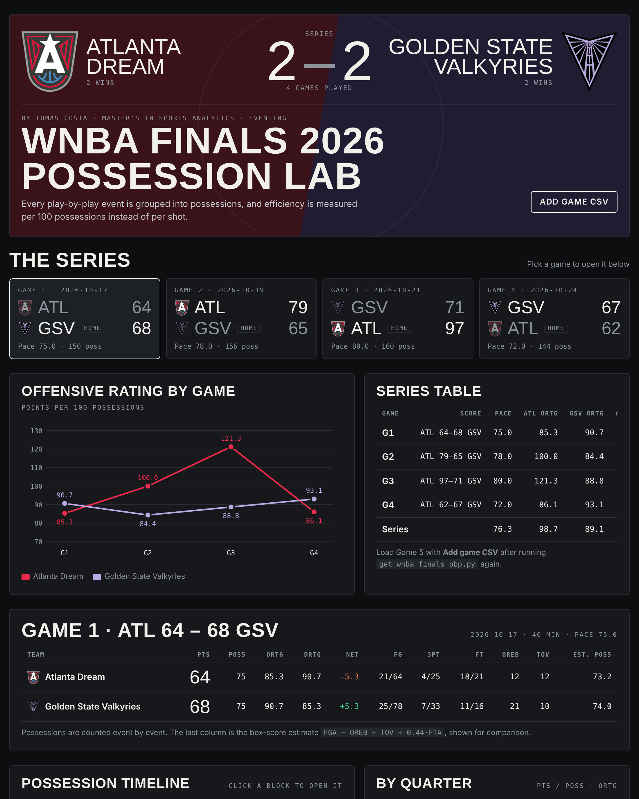
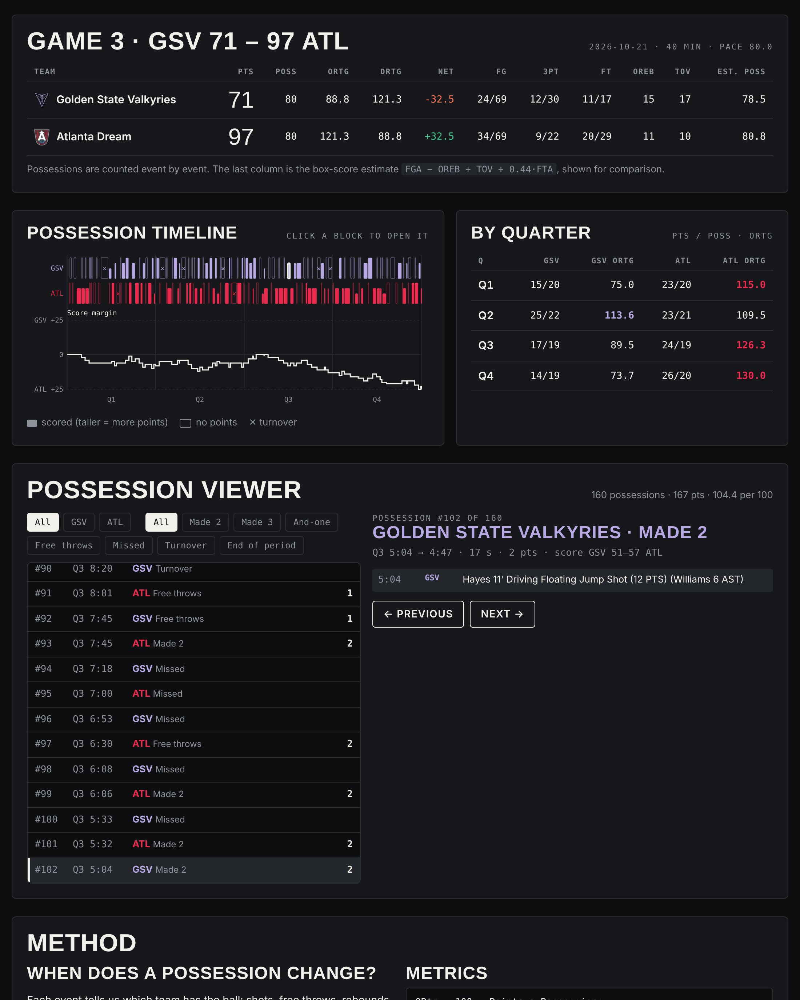

# WNBA Finals 2026 · Possession Lab

**Author:** Tomás Costa · Master's in Sports Analytics, Escuela Universitaria Real Madrid – Universidad Europea

Possession-based eventing analysis of the 2026 WNBA Finals (Atlanta Dream vs Golden State Valkyries).

**Live tool:** open `index.html` in any browser, or visit the GitHub Pages link of this repository.



## What it does

1. **Extracts the event data.** The official play-by-play of every Finals game comes from the WNBA stats API (`PlayByPlayV3`) and is saved as one CSV per game (`data/`).
2. **Rebuilds every possession event by event.** Shots, free throws, rebounds and turnovers tell us which team has the ball. A new possession starts when that team changes or a quarter starts.
3. **Measures efficiency independently of tempo:**

| Metric | Definition |
|---|---|
| ORtg (offensive efficiency) | 100 × points ÷ possessions |
| DRtg (defensive efficiency) | opponent's ORtg |
| Net rating | ORtg − DRtg |
| Pace | average possessions × 40 ÷ minutes played |
| Estimated possessions | FGA − OREB + TOV + 0.44 × FTA (box-score estimate, shown for comparison) |

## Possession rules

- Made shot, last free throw made, or turnover → the ball goes to the other team.
- Defensive rebound → new possession for the rebounding team.
- Offensive rebound → the same possession continues.
- And-one and flagrant free throws stay in the same possession; technical free throws do not open a possession.
- Team rebounds and shot-clock turnovers have no player; the team comes from the `personId` field.

Validation: points rebuilt from the events match the official running score on every scoring play of all four games.

## Views

- **Series:** game cards, offensive rating by game, series table (pace, ORtg, net rating).
- **Game:** team efficiency table with real vs estimated possessions, efficiency by quarter.
- **Possession timeline:** every possession over 40 minutes, coloured by team and outcome, with the score margin underneath.
- **Possession viewer:** filter by team and outcome, open any possession and see the events that make it up.



## Results

| Game | Result | Pace | ATL ORtg | GSV ORtg |
|---|---|---|---|---|
| G1 | GSV 68–64 | 75.0 | 85.3 | 90.7 |
| G2 | ATL 79–65 | 78.0 | 100.0 | 84.4 |
| G3 | ATL 97–71 | 80.0 | 121.3 | 88.8 |
| G4 | GSV 67–62 | 72.0 | 86.1 | 93.1 |

Golden State's offense stays between 84 and 93; Atlanta's swings from 85 to 121. Golden State won the two slowest games.

## Repository

```
index.html                 the tool (self-contained, data embedded)
data/                      play-by-play CSV per game
scripts/get_wnba_finals_pbp.py   downloads the play-by-play (nba_api)
images/                    screenshots
```

To add a new game: run `pip3 install nba_api pandas` and `python3 scripts/get_wnba_finals_pbp.py`, then use **Add game CSV** in the tool.

---
Tomás Costa · Master's in Sports Analytics · Escuela Universitaria Real Madrid – Universidad Europea
